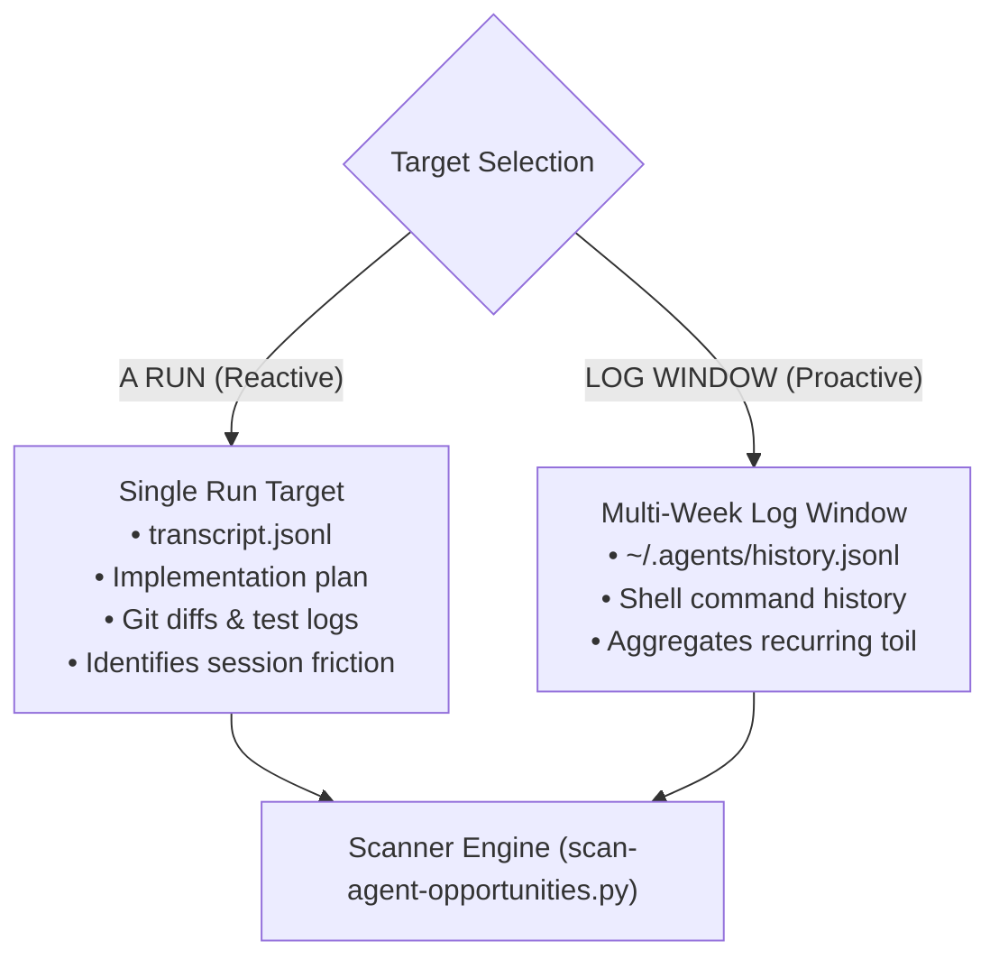

# Agent Opportunity Scan Architecture Specification

## 💡 Strategic Context & Rationale
*Master Index:* [index.md](../index.md)  
*Construction Engine:* [Build Agent Engine Architecture](arch-build-agent-engine.md)  
*Pipeline Integration:* [Sequential Pipeline Integration](arch-sequential-pipeline-integration.md)

`agent-opportunity-scan` acts as **Stage 0** in the agent engineering lifecycle. It automates the detection and qualification of software workflows that should be turned into autonomous agents, pre-compiling their specifications to feed directly into `/build-agent`.

---

## 1. Dual-Target Intake Pipeline

Inherited from the `opportunity-scan` discovery paradigm, the scanner supports two distinct scanning targets:

---

## 2. The Dual-Tier Viability Taxonomy

To eliminate over-engineering and ensure high ROI, every candidate must clear a strict two-tier filter:

### 🔴 Tier 1: The 5 Critical Qualification Gates (Mandatory Binary Barrier)
Every candidate must pass ALL 5 gates:
1. **CG-1: Dynamic State & Branching (Anthropic §2):** Non-deterministic exploration/branching required. *(Fails to: Shell Script/Rule).*
2. **CG-2: External Tool Mutation (CoALA §3):** Coordinates tool actions with environment mutations. *(Fails to: Prompt/Skill).*
3. **CG-3: Reflexion & Error Recovery (Ng Pattern 1):** Self-healing and dynamic exception recovery required. *(Fails to: Git Hook).*
4. **CG-4: Measurable Toil Justification (Chip Huyen §3):** Toil $\ge 15$ mins/week or recurring ($AVS \ge 50$). *(Fails to: Ad-hoc manual execution).*
5. **CG-5: Containable Blast Radius (SWE-bench):** Scoped mutations with rollback feasible. *(Fails to: Human-only task).*

### 🟢 Tier 2: The 5 Optional Value-Add Enhancers (Feature Multipliers)
Boost the candidate's Agent Viability Score and pre-configure advanced features:
- **OE-1: Episodic Memory:** Cross-session state logging (`.agents/memory/`).
- **OE-2: Multi-Perspective Deliberation:** Promotes to `multi-agent-squad`.
- **OE-3: Persistent Sentinel Scheduling:** Classifies as `autonomous-sentinel`.
- **OE-4: Dynamic MCP Integration:** Integrates external third-party tools.
- **OE-5: Multimodal Sensory Grounding:** Integrates UI/browser perception.

---

## 3. Agent Viability Score (AVS) Formulation

$$\text{AVS} = \frac{\text{Monthly Frequency} \times \text{Mean Human Toil (Minutes)}}{\text{Blast Radius Factor}} \times \left(1 + 0.15 \times N_{\text{optional}}\right)$$

Candidates with $AVS \ge 100$ are flagged as **Immediate Build Candidates**.

---

## 4. The Pre-Compiled Specification Dossier

For each qualified candidate, the scan outputs:
- **Candidate Name & Archetype**
- **Observed Friction & Session Evidence**
- **Required Tool Palette & CoALA Action Boundaries**
- **Definition of Done (DoD) & Acceptance Criteria**
- **Fired Conditions** (2 negative termination triggers)
- **1-Click `/build-agent` Invocation Command**

---

## 🔗 Related Knowledge Base Links
* 🏠 [Master Index](../index.md)
* 🏗️ [Build Agent Engine Architecture](arch-build-agent-engine.md)
* 🔄 [Sequential Pipeline Integration](arch-sequential-pipeline-integration.md)
* 🎯 [Dual-Tier Viability Rubric](../guides/guide-dual-tier-viability-rubric.md)
