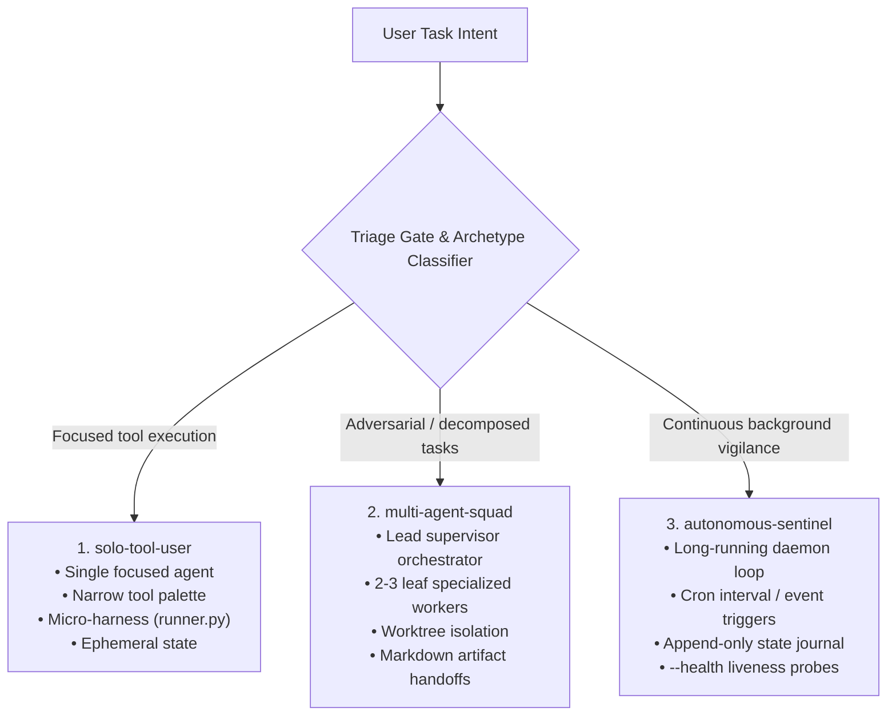

# Build Agent Engine Architecture Specification

## 💡 Strategic Context & Rationale
*Master Index:* [index.md](../index.md)  
*Research Scaffolding:* [Top 5 Specifications](../../research%20references/01-top-5-agent-specifications.md)  
*Upstream Discovery:* [Agent Opportunity Scan Architecture](arch-agent-opportunity-scan.md)

`build-agent` is the systems-engineering skill for creating autonomous agents and multi-agent teams. It converts any natural language task description into a formal 6-dimension specification sheet, conducts a risk-weighted interview, and scaffolds complete operational systems into the `.agents/` runtime directory.

---

## 1. The 3 Core Architectural Archetypes

`build-agent` maps all requests into exactly one of three structural archetypes:



---

## 2. The 4-Stage Operational Protocol

```text
[User explains task in plain English]
                 ↓
Stage 1: Intent Intake & Triage Gate
• Evaluates Anthropic Workflow vs Agent boundary
• Classifies Archetype (solo, squad, sentinel)
• Populates 6-Dimension Spec Sheet
                 ↓
Stage 2: Mandatory Approval Barrier
• Hard stop: User must review and approve Spec Sheet
• Options: (A) Approve as-is, (B) Calibrate, (C) Abort
                 ↓
Stage 3: Risk-Weighted Guided Walkthrough Interview
• Station 1: Domain Grounding & Blast Radius (CONTEXT.md)
• Station 2: Team Roster & Handoff Contracts (squad only)
• Station 3: Human-in-the-Loop Interventions (ask_human)
• Station 4: Acceptance Test & Fired Conditions
                 ↓
Stage 4: Multi-Substrate Scaffolding & Activation
• Narrative Spec: .agents/specs/<name>.spec.md
• Oracle Spec: .agents/specs/<name>.spec.yaml
• Subagent Definition: .agents/agents/<Name>/agent.md
• Python Micro-Harness: .agents/agents/<Name>/runner.py
• Master Registry: .agents/agents.json
• Smoke test: Verification via --health and --mock
```

---

## 3. The 6 Dimensions of the Specification Sheet

Stored in `.agents/specs/<name>.spec.md`:
1. **Identity & Core Mission:** Clear, bounded purpose.
2. **Context & Invariants:** Grounded in workspace `CONTEXT.md`.
3. **Execution Topology:** Workflow DAG, autonomous loop, or squad.
4. **Tool Palette & Action Space Boundaries:** Permitted tools and blocklisted shell commands.
5. **Human-in-the-Loop Interventions:** Exact triggers for human authorization.
6. **Verification, Definition of Done & Fired Conditions:** Acceptance criteria and negative termination triggers.

---

## 4. Multi-Substrate Deliverables Inventory

Every agent constructed by `build-agent` produces 4 concrete artifacts:
- **`.agents/specs/<name>.spec.md`**: Human-readable architectural spec.
- **`.agents/specs/<name>.spec.yaml`**: Machine-readable Oracle `agent-spec` compliant YAML.
- **`.agents/agents/<Name>/agent.md`**: Native Antigravity subagent definition with YAML frontmatter.
- **`.agents/agents/<Name>/runner.py`**: Standalone zero-dependency Python harness with REST adapter, git rollback, 16KB payload armor, and `--health` / `--mock` CLI flags.

---

## 🔗 Related Knowledge Base Links
* 🏠 [Master Index](../index.md)
* 🔍 [Agent Opportunity Scan Architecture](arch-agent-opportunity-scan.md)
* 🔄 [Sequential Pipeline Integration](arch-sequential-pipeline-integration.md)
* 🛡️ [Runtime Harness Specification](arch-runtime-harness-and-armor.md)
