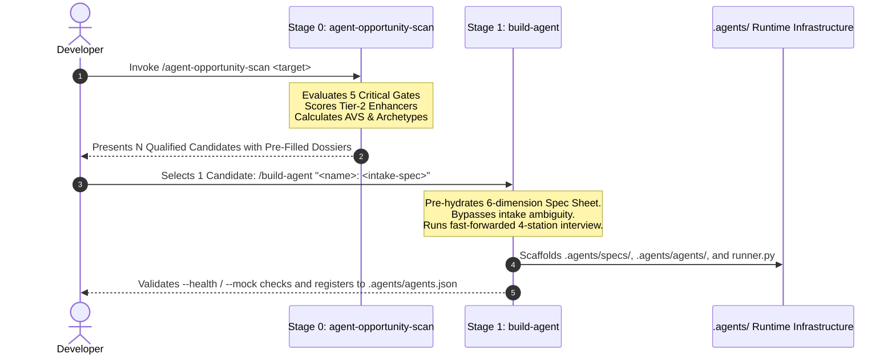

# Sequential Pipeline Integration: Discovery to Construction

## 💡 Strategic Context & Rationale
*Master Index:* [index.md](../index.md)  
*Upstream Discovery:* [Agent Opportunity Scan Architecture](arch-agent-opportunity-scan.md)  
*Construction Engine:* [Build Agent Engine Architecture](arch-build-agent-engine.md)

Software engineers frequently struggle with two opposing failure modes when adopting agentic tooling:
1. **Spec-Writing Fatigue:** Manually drafting complex YAML specifications and prompt harnesses from scratch is slow and prone to omission.
2. **Cargo-Cult Agentification:** Turning trivial tasks into complex, flaky agent loops that should have been 2-line bash scripts.

The **Sequential Two-Stage Pipeline** eliminates both problems.

---

## 1. The Two-Stage Protocol

---

## 2. Invariant Rules of the Pipeline

1. **Broad Discovery, Narrow Construction:** `agent-opportunity-scan` can surface **as many candidates as meet the criteria** ($N \ge 1$). However, `build-agent` constructs **only one agent at a time** to maintain strict architectural focus and prevent context pollution.
2. **Zero Information Loss Handoff:** Every candidate dossier produced by Stage 0 contains the exact fields required by Stage 1:
   - Candidate Identifier & Archetype
   - Trigger Condition & Session Evidence
   - Tools & CoALA Action Boundaries
   - Definition of Done & Acceptance Criteria
   - Fired Conditions (termination triggers)
3. **Optional Declarative Pre-Seeding (`--auto-spec`):** When `--auto-spec` is passed to the scanner, it writes a starter Oracle specification to `.agents/specs/<candidate-id>.spec.yaml`, which `build-agent` can immediately load and refine.

---

## 🔗 Related Knowledge Base Links
* 🏠 [Master Index](../index.md)
* 🔍 [Agent Opportunity Scan Architecture](arch-agent-opportunity-scan.md)
* 🏗️ [Build Agent Engine Architecture](arch-build-agent-engine.md)
* 🧭 [Operational Workflow Guide](../guides/guide-dual-skill-operational-workflow.md)
