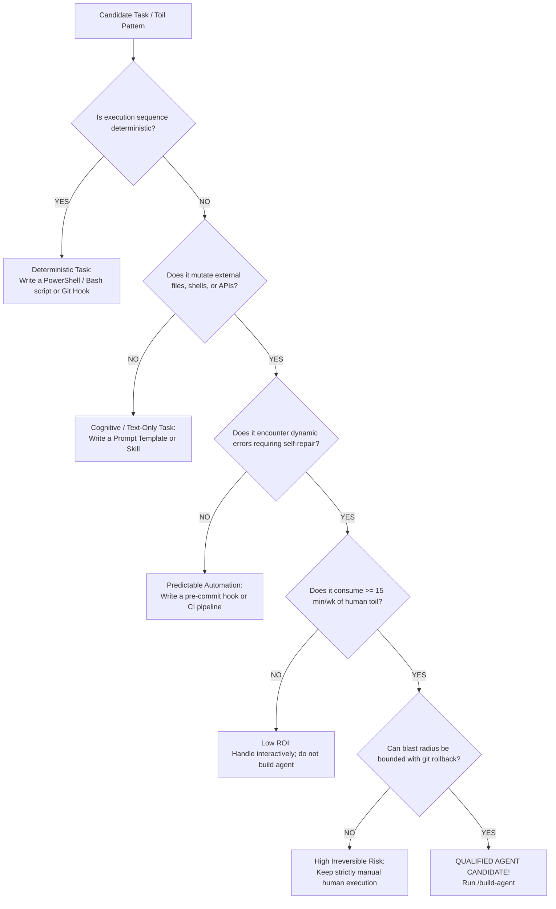

# Quick-Reference Guide: Dual-Tier Viability Rubric & Decision Trees

## 💡 Strategic Context & Rationale
*Master Index:* [index.md](../index.md)  
*Upstream Discovery:* [Architecture: Agent Opportunity Scan](../architecture/arch-agent-opportunity-scan.md)

Use this quick-reference checklist during planning or retro sessions to rapidly evaluate whether a task should become an **Agent**, a **Skill**, a **Hook**, or a **Script**.

---

## 1. The Decision Tree

---

## 2. The 5 Critical Gates Checklist

Before proposing or approving an agent, check all 5 boxes:
- [ ] **CG-1: Dynamic State & Branching:** Requires multi-turn planning and dynamic adaptation.
- [ ] **CG-2: External Tool Mutation:** Drives side-effects via tools (files, terminal, network).
- [ ] **CG-3: Reflexion & Error Recovery:** Catches exceptions and self-corrects without crashing.
- [ ] **CG-4: Measurable Toil Justification:** Costs $\ge 15$ mins/week or occurs frequently ($AVS \ge 50$).
- [ ] **CG-5: Containable Blast Radius:** Mutations can be rolled back via git stash.

---

## 3. Tier 2 Optional Enhancers (Bonus Scoring)

Count how many enhancers are met ($0$ to $5$):
- [ ] **OE-1: Episodic Cross-Session Memory** (+15% bonus)
- [ ] **OE-2: Multi-Perspective Deliberation** (+15% bonus $\to$ Promotes to `multi-agent-squad`)
- [ ] **OE-3: Persistent Sentinel Scheduling** (+15% bonus $\to$ Promotes to `autonomous-sentinel`)
- [ ] **OE-4: Dynamic MCP Tool Integration** (+15% bonus)
- [ ] **OE-5: Multimodal Sensory Grounding** (+15% bonus)

$$\text{AVS} = \frac{\text{Monthly Frequency} \times \text{Mean Toil (Minutes)}}{\text{Blast Radius Factor}} \times \left(1 + 0.15 \times N_{\text{optional}}\right)$$

---

## 🔗 Related Knowledge Base Links
* 🏠 [Master Index](../index.md)
* 🔍 [Agent Opportunity Scan Architecture](../architecture/arch-agent-opportunity-scan.md)
* 🧭 [Operational Workflow Guide](guide-dual-skill-operational-workflow.md)
