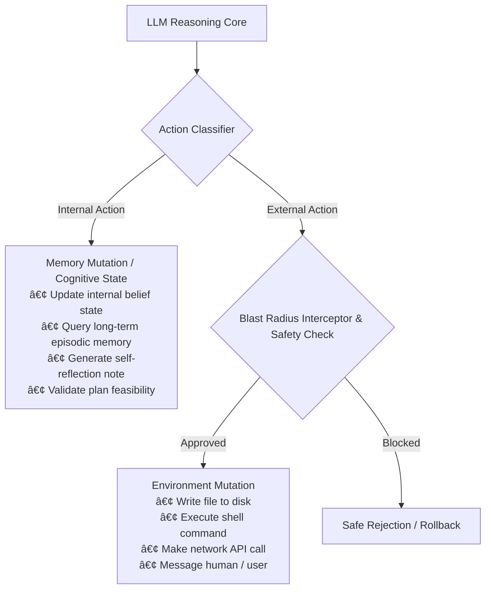

# CoALA Cognitive Architecture for Language Agents

## 💡 Strategic Context & Rationale
*Foundational Survey:* [Top 5 Specifications](01-top-5-agent-specifications.md)  
*Runtime Implementation:* [Architecture: Runtime Harness & Armor](../docs/architecture/arch-runtime-harness-and-armor.md)

CoALA (Sumers, Yao, Narasimhan, Griffiths, 2024) provides the formal computational and structural blueprint for engineering AI agents that go beyond stateless prompt calls.

---

## 1. The CoALA Memory Taxonomy

CoALA organizes agent memory into four functionally distinct substrates:

```text
┌────────────────────────────────────────────────────────┐
│                   WORKING MEMORY                       │
│  • Active context window buffer                        │
│  • Current execution goal & sub-goals                  │
│  • Scratchpad variables & intermediate plan states     │
└────────────────────────────────────────────────────────┘
          â–²                     â–²                   â–²
          │ Retrieval           │ Logs              │ Lookups
          â–¼                     â–¼                   â–¼
┌──────────────────┐  ┌──────────────────┐  ┌──────────────────┐
│ EPISODIC MEMORY  │  │ SEMANTIC MEMORY  │  │PROCEDURAL MEMORY │
│ Past execution   │  │ Declarative domain│  │ Reusable skills,│
│ trials, traces,  │  │ knowledge, facts, │  │ system prompts, │
│ & failure logs   │  │ CONTEXT.md rules  │  │ tool schemas    │
└──────────────────┘  └──────────────────┘  └──────────────────┘
```

1. **Working Memory:** The fast, volatile context window holding the active goal, current observation, and immediate reasoning scratchpad. Constrained by token limits; requires periodic compaction.
2. **Episodic Memory:** Chronological database of previous executions, task outcomes, and reflection traces (`.agents/memory/*.jsonl`). Allows agents to learn from past mistakes across sessions.
3. **Semantic Memory:** Static declarative knowledge base containing domain invariants, coding conventions, architectural decisions, and `CONTEXT.md`.
4. **Procedural Memory:** The executable instructions, prompt templates, tool schemas, and runner harnesses (`runner.py`, `agent.md`) that dictate how the agent operates.

---

## 2. Action Space Decoupling: Internal vs. External Actions

The cornerstone invariant of CoALA is the strict computational separation of an agent's action space:



### Why Decoupling is Mandatory
In naive ReAct agents, internal planning tokens and external API calls are mingled indiscriminately, causing:
- Accidental execution of half-formed plans.
- Hallucinated commands triggered before verifying schema compliance.
- Inability to roll back corrupted local state.

In our architecture, an agent must formulate and verify its internal belief state **before** triggering an external environment mutation.

---

## 3. The Generalized 3-Stage Decision Cycle

Every agent loop in the suite executes CoALA's 3-stage decision cycle:
1. **Planning & Retrieval:** The agent reads active working memory, retrieves relevant domain rules from semantic memory, and pulls past failure lessons from episodic memory.
2. **Action Selection:** The model evaluates candidate actions, chooses between an internal cognitive update or an external tool execution, and validates parameters against schema contracts.
3. **Execution & Feedback:** If an external action is selected, the runtime executes the tool, captures stdout/stderr, applies payload armor (16KB ceiling), and updates working memory with the observation.

---

## 🔗 Related Knowledge Base Links
* 🏠 [Master Index](index.md)
* 📚 [Top 5 Foundational Specifications](01-top-5-agent-specifications.md)
* 🏗️ [Build Agent Engine Architecture](../docs/architecture/arch-build-agent-engine.md)
* 🛡️ [Runtime Harness Specification](../docs/architecture/arch-runtime-harness-and-armor.md)

