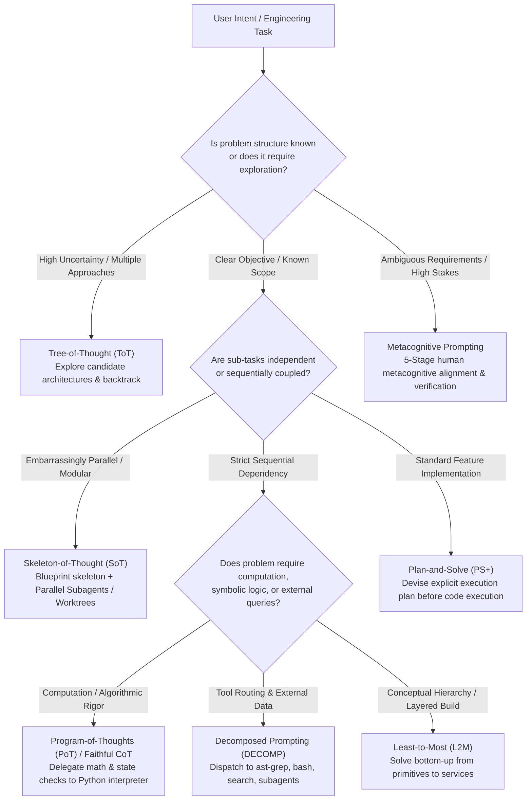
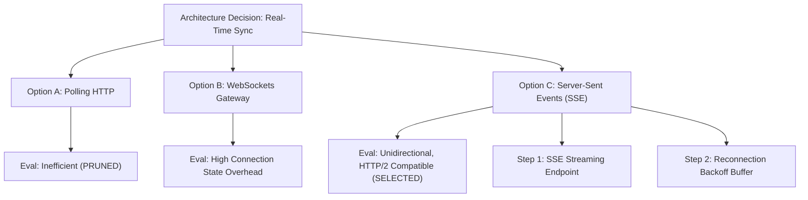
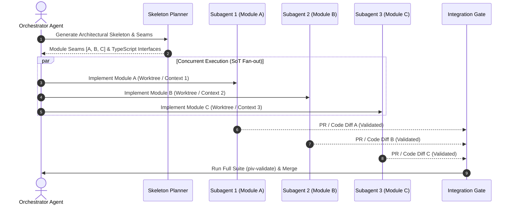

# Prompt Decomposition: Structured Execution Graphs for Agentic Engineering

> **"Decomposition techniques break down a complex problem into smaller, more manageable sub-problems, and then combine the solutions to solve the original problem."**
> — *The Prompt Report: A Systematic Survey of Prompting Techniques* (Schulhoff et al., 2025, §2.2.3, pp. 13–14)

Large Language Models struggle with monolithic, high-entropy tasks due to autoregressive error propagation, attention diffusion across large contexts, and the inability to backtrack once a generation path commences. In software engineering, attempting to implement a multi-module feature or architectural refactor in a single prompt generates shallow vibe-code, missed edge cases, and brittle regressions.

This skill operationalizes the entire **Decomposition taxonomy from Figure 2.2 of The Prompt Report (Schulhoff et al., 2025)** into actionable execution graphs, subagent fan-out patterns, and deterministic tool delegation boundaries within Google Antigravity.

---

## 1. The Decomposition Taxonomy (Figure 2.2 Matrix)

The 9 foundational decomposition techniques classified in Schulhoff et al. (2025) address distinct computational bottlenecks. The table below maps each technique to its theoretical origin, cognitive topology, execution substrate, and its concrete realization in the Unified Antigravity Engineering OS.

| Technique | Academic Citation | Topology & Mechanism | Compute Substrate | Antigravity Mapping & Primitives |
| :--- | :--- | :--- | :--- | :--- |
| **Least-to-Most Prompting** | Zhou et al. (2022a) | **Sequential Bottom-Up DAG:** Decompose into sub-problems without solving; solve sequentially passing prior outputs as context. | Pure LLM (Sequential) | Bottom-up layer implementation: Primitives $\rightarrow$ Models $\rightarrow$ Logic $\rightarrow$ API endpoints. |
| **Decomposed Prompting (DECOMP)** | Khot et al. (2022) | **Hierarchical Tool Routing:** Decompose tasks into sub-tasks dispatched to specialized functions, prompts, or tools. | Hybrid LLM + Specialized Tools | Dispatching sub-tasks to dedicated CLI tools (`ast-grep`, `run_command`), search, or specialized subagents. |
| **Plan-and-Solve Prompting (PS / PS+)** | Wang et al. (2023f) | **Explicit Multi-Step Planning:** Replace generic zero-shot CoT with explicit planning phase before step-by-step execution. | Pure LLM (Two-Phase) | PIV Planning loop: Intent analysis $\rightarrow$ Local ticket breakdown in `.agents/tickets/` prior to any code edit. |
| **Tree-of-Thought (ToT)** | Yao et al. (2023b); Long (2023) | **Tree Search with Pruning:** Generate multiple candidate thoughts per node, evaluate state heuristic, backtrack on dead-ends. | LLM + Search Algorithm (BFS/DFS) | Architectural exploration (`plan-architecture`), ADR candidate evaluation, spike branch validation, and pruning. |
| **Recursion-of-Thought (RoT)** | Lee & Kim (2023) | **Recursive Context Partitioning:** Sub-calls spawned when sub-problems exceed local context window or depth budget. | LLM with Nested Sub-calls | Context-overflow mitigation via `invoke_subagent` with clean isolated memory contexts, returning distilled summaries. |
| **Program-of-Thoughts (PoT)** | Chen et al. (2023d) | **Symbolic Decoupling:** Disentangle reasoning from computation by expressing logic as executable code. | LLM (CodeGen) + External Interpreter | Offloading math, AST diffs, schema parsing, and calculations to Python scripts executed via `run_command`. |
| **Faithful Chain-of-Thought** | Lyu et al. (2023) | **Bilingual Translation:** Translate problem into natural language + formal symbolic language guaranteed by execution trace. | LLM + Formal Execution Engine | Matt Pocock invariant seams, red-green TDD test harnesses, and type assertions verified before diff commits. |
| **Skeleton-of-Thought (SoT)** | Ning et al. (2023) | **Parallel Decoding:** Decouple structural skeleton generation from concurrent expansion of independent points. | LLM (Parallel Fan-Out) | Fan-out subagent orchestration (`invoke_subagent`) or concurrent Git worktrees (`worktree-create`) for independent modules. |
| **Metacognitive Prompting** | Wang & Zhao (2024) | **5-Stage Reflexive Loop:** Emulate human metacognition (clarification, preliminary judgment, evaluation, confirmation, confidence). | Self-Reflective LLM | Socratic grilling (`/grill-me`), pre-flight alignment, and two-axis code reviews (`piv-review`, `design-review`). |

---

## 2. Strategy Selection Router

When receiving a complex task or intent, evaluate the problem topology against this decision tree to select the optimal decomposition strategy (or combination of strategies):



---

## 3. Deep Dive: The 9 Decomposition Paradigms

### 3.1 Least-to-Most Prompting (Zhou et al., 2022a)
- **Problem Solved:** Compounding errors where solving a high-level goal directly leads to hallucinations or incorrect assumptions about underlying primitives.
- **Protocol:**
  1. **Decomposition Phase:** Ask: *"What sub-problems must be solved to answer [Problem], without solving them yet?"* Output an ordered dependency DAG: $S_1, S_2, \dots, S_n$.
  2. **Sequential Resolution Phase:**
     - Step 1: Solve $S_1 \rightarrow A_1$.
     - Step 2: Input $(Problem, S_1, A_1, S_2) \rightarrow A_2$.
     - Step $k$: Input $(Problem, S_1, A_1, \dots, S_{k-1}, A_{k-1}, S_k) \rightarrow A_k$.
- **Antigravity Software Engineering Application:**
  - Build from the bottom of the dependency stack up: Domain Types $\rightarrow$ Invariant Seams $\rightarrow$ Storage Adapter $\rightarrow$ Domain Service $\rightarrow$ API Controller $\rightarrow$ Client Interface.

#### Before vs. After Example:
- ❌ **Monolithic (Before):**
  > "Add Stripe webhook handling for subscription upgrades with prorated billing and database syncing."
  *(Result: Agent edits 5 files at once, confuses database transaction states, and hallucinates Stripe signature verification logic).*
- ✅ **Least-to-Most (After):**
  ```markdown
  ### Least-to-Most Execution Plan:
  1. [Subproblem 1]: Define the TypeScript domain schema for `SubscriptionPayload` and proration event types.
  2. [Subproblem 2 - depends on 1]: Implement the deterministic signature verification middleware using raw byte buffers.
  3. [Subproblem 3 - depends on 1]: Write isolated domain logic for calculating prorated credit balances.
  4. [Subproblem 4 - depends on 2, 3]: Wire the webhook route handler with idempotent database transactions.
  5. [Subproblem 5 - depends on 4]: Add end-to-end integration tests using mocked Stripe payloads.
  ```

---

### 3.2 Decomposed Prompting / DECOMP (Khot et al., 2022)
- **Problem Solved:** General-purpose LLMs attempting to solve specialized sub-tasks (regex parsing, structural AST queries, shell executions) internally within token memory.
- **Protocol:**
  - Break tasks into discrete sub-operations, each handled by a dedicated handler or tool.
  - Handlers maintain isolated state and specialized prompts.
- **Antigravity Software Engineering Application:**
  - Orchestrate between native Antigravity tools:
    - Codebase structural query $\rightarrow$ offload to `ast-grep` or `run_command` with ripgrep.
    - External research $\rightarrow$ invoke `research` subagent.
    - Deterministic data transformation $\rightarrow$ run Python script via `run_command`.
    - Code modifications $\rightarrow$ execute via `replace_file_content` or `write_to_file`.

#### Tool Delegation Schema:
```text
[Main Orchestrator Agent]
       │
       ├── (AST Pattern Match) ───────► ast-grep MCP / CLI
       ├── (External Specs/Docs) ─────► Research Subagent / Browser
       ├── (Complex JSON/Data Math) ──► python scratch script
       └── (Code Modification) ───────► replace_file_content
```

---

### 3.3 Plan-and-Solve Prompting / PS+ (Wang et al., 2023f)
- **Problem Solved:** Missing variables, skipped intermediate calculation steps, and cognitive drift in zero-shot CoT ("Let's think step by step").
- **Protocol (PS+ Variant):**
  1. **Plan:** *"Let's first understand the problem, extract the relevant variables and constraints, devise a plan of atomic tasks with acceptance criteria, and identify critical test cases."*
  2. **Solve:** *"Now let's carry out the plan step by step, validating each step before proceeding to the next."*
- **Antigravity Software Engineering Application:**
  - Core driver of the PIV Planning phase. The agent writes an explicit local ticket in `.agents/tickets/<NNN>-<title>.md` containing task slices, invariant checks, and unit test requirements before writing any application code.

---

### 3.4 Tree-of-Thought / ToT (Yao et al., 2023b; Long, 2023)
- **Problem Solved:** Premature commitment to suboptimal architectural choices; inability to explore divergent solutions or recover from dead-ends.
- **Protocol:**
  1. **Thought Generation:** At state $s$, generate $k$ alternative candidate thoughts/designs: $\{t_1, t_2, \dots, t_k\}$.
  2. **State Evaluation:** Evaluate each candidate against objective criteria (e.g., performance, cognitive load, migration friction) scoring: `Sure`, `Likely`, or `Impossible`.
  3. **Search & Prune:** Execute BFS or DFS. Prune `Impossible` branches.
  4. **Backtracking:** If a path hits an intractable obstacle or violates an invariant seam, backtrack to the nearest viable parent node.
- **Antigravity Software Engineering Application:**
  - Used in `/plan-architecture` and `/rca-centroidal-fork`. Explore 3 candidate architectural spikes. If Spike B fails type checks or benchmarks, prune and backtrack to Spike A.



---

### 3.5 Recursion-of-Thought / RoT (Lee & Kim, 2023)
- **Problem Solved:** Tasks that exceed the effective context window, causing catastrophic forgetting, context saturation, and attention dilution.
- **Protocol:**
  - Define an operational depth and size limit.
  - When a sub-task's input space or complexity exceeds threshold:
    1. Emit an explicit sub-call trigger: `[DELEGATE: <sub-problem-spec>]`.
    2. Dispatch an isolated child subagent with a fresh conversation context.
    3. The child subagent completes its task, produces an artifact or concise summary, and returns the distilled result.
    4. The parent agent resumes execution with the distilled output, preserving its local token window.
- **Antigravity Software Engineering Application:**
  - Large-scale refactoring across 30+ files. The parent agent dispatches child subagents (`invoke_subagent`) to audit or refactor individual directory sub-trees, collecting only the change manifests and validation receipts.

---

### 3.6 Program-of-Thoughts / PoT (Chen et al., 2023d)
- **Problem Solved:** LLM token arithmetic and string parsing errors. Neural language models are stochastic pattern-matchers, not arithmetic ALUs or regex engines.
- **Protocol:**
  - Express reasoning logic, data transformation, or calculations as executable Python code.
  - Execute code via external runtime environment.
  - Capture standard output and feed back into the reasoning trace.
- **Antigravity Software Engineering Application:**
  - Whenever line calculations, AST node transformations, token budget accounting, or cryptographic hash computations are needed, author a temporary Python script in `<appDataDir>\brain\<id>\scratch\calculate.py` and run it with `run_command`.

#### PoT Rule of Thumb in Antigravity:
> [!IMPORTANT]
> **NEVER compute in prompt tokens what an interpreter executes deterministically:**
> - Parsing 1,000-line logs $\rightarrow$ Python script via `run_command`.
> - Counting lines, bytes, or diff chunks $\rightarrow$ PowerShell / Python CLI.
> - Checking schema invariants $\rightarrow$ Deterministic unit test runner.

---

### 3.7 Faithful Chain-of-Thought (Lyu et al., 2023)
- **Problem Solved:** "Unfaithful" reasoning where the model writes plausible-sounding natural language rationales that do not match the actual code it outputs.
- **Protocol:**
  - Structure the problem as a bilingual interleaving of natural language intent and formal executable specification (e.g., explicit type signatures, pre/post-conditions, executable assertions).
  - The final solution is valid *if and only if* it executes through the formal harness without contradiction.
- **Antigravity Software Engineering Application:**
  - Strict Test-Driven Development (TDD) via `tdd` skill. Write the failing unit test (`RED`) with precise assertions. Implement minimal code (`GREEN`). Refactor. The test runner (`piv-validate`) acts as the deterministic arbiter of truth.

---

### 3.8 Skeleton-of-Thought / SoT (Ning et al., 2023)
- **Problem Solved:** High end-to-end generation latency in long, multi-section implementations.
- **Protocol:**
  1. **Skeleton Stage:** Guide the LLM to output a concise, structured skeleton (a blueprint of decoupled components or points) without expanding any details.
  2. **Point-Expanding Stage:** Concurrently expand all skeleton points in parallel.
  3. **Integration Stage:** Coalesce the generated sections into the final unified artifact.
- **Antigravity Software Engineering Application:**
  - Parallel subagent fan-out! In Phase A, author the blueprint defining invariant seams and contracts between modules. In Phase B, launch parallel subagents (`invoke_subagent`) or spin up parallel git worktrees (`worktree-create`) to implement each module concurrently. In Phase C, run `worktree-merge` and `piv-validate`.



---

### 3.9 Metacognitive Prompting (Wang & Zhao, 2024)
- **Problem Solved:** Confirmation bias, overlooked edge cases, and unwarranted confidence during alignment and requirements analysis.
- **Protocol (5-Stage Cognitive Emulation):**
  1. **Phase 1: Clarification & Problem Understanding:** Identify explicit inputs, implicit constraints, system invariants, and ambiguous terms.
  2. **Phase 2: Preliminary Judgment:** Formulate an initial engineering approach and state the working assumptions.
  3. **Phase 3: Critical Evaluation & Counter-Perspective:** Scrutinize the preliminary judgment: *Where does this break under load? What does this assume about concurrency or state? What is the antipodal failure mode?*
  4. **Phase 4: Confirmation & Strategy Adjustment:** Revise the strategy to eliminate identified flaws and establish hard boundaries.
  5. **Phase 5: Confidence & Verifiability Scoring:** Quantify confidence ($0.0 - 1.0$) based on empirical testability; define concrete falsification tripwires.
- **Antigravity Software Engineering Application:**
  - Deployed during Socratic grilling (`/grill-me`, `/grill-with-duality`) and pre-commit review gates (`piv-review`).

---

## 4. Execution Protocol: How to Run `prompt-decomposition`

When this skill is invoked via `/prompt-decomposition <task>` or with `--strategy <name>`:

### Step 1: Input Analysis & Triage
1. Read the input task, target files, and any associated PRD or ticket.
2. Determine if the user explicitly provided `--strategy`. If not, run the **Strategy Selection Router (§2)** to select the primary decomposition archetype.
3. If intent is underspecified, execute **Metacognitive Phase 1 (Clarification)** and ask targeted questions via `ask_question`.

### Step 2: Synthesis of the Decomposed Execution Graph
Construct an execution artifact formatted as a structured DAG:
- **Node ID**: Sequential identifier (e.g., `TASK-01`, `TASK-02`).
- **Decomposition Archetype**: (L2M, DECOMP, PS+, ToT, RoT, PoT, Faithful CoT, SoT, Metacognitive).
- **Subproblem Scope**: Exact boundary of responsibility (Matt Pocock deep module seam).
- **Prerequisites**: Dependent upstream task IDs.
- **Compute Substrate / Tool**: (Native Agent, `invoke_subagent`, `run_command` Python script, `ast-grep`, git worktree).
- **Invariant Seam / Acceptance Assertion**: Falsifiable check (type check, unit test, regex match) that determines success before proceeding.

### Step 3: Execution & Delegation Boundaries

#### When using `sot` (Skeleton-of-Thought / Fan-out):
1. **Contract Freeze:** You MUST write the TypeScript/Python interfaces and shared type declarations to disk *first* before fanning out.
2. **Subagent Dispatch:** Call `invoke_subagent` for each independent skeleton node. Pass each subagent its strict file boundary and the pre-written shared interface.
3. **Barrier Synchronization:** Wait for all subagents to report completion. Run `piv-validate` to confirm cross-module integration.

#### When using `decomp` or `pot` (External Offloading):
1. **Never guess calculations:** Generate a script in `<appDataDir>\brain\<conversation-id>/scratch/` to compute complex state or transform data.
2. Execute via `run_command` and inject the standard output into the parent conversation.

#### When using `tot` (Tree-of-Thought):
1. Document the 2–3 candidate branches with their respective trade-offs in an ADR format (`.agents/adr/`).
2. Run minimal exploratory spikes.
3. Prune failed spikes with an explicit reason; advance the winning branch into a linear Least-to-Most execution plan.

---

## 5. Concrete Reference Examples

### Example A: Full-Stack Feature via Hybrid SoT + DECOMP + L2M
**Scenario:** "Add a real-time collaborative cursor tracking system to our canvas editor."

#### 1. Metacognitive Pre-Flight Alignment:
- *Clarification:* WebSocket vs WebRTC DataChannels? (Decision: WebSockets via existing cluster).
- *Antipodal Risk:* Network saturation from raw mousemove events (60-120Hz).
- *Invariant:* Cursors must be rate-limited/throttled to 30ms and serialized as binary packed buffers.

#### 2. Skeleton-of-Thought (SoT) Architectural Blueprint:
```markdown
├── Seam 1: Shared Binary Protocol Definition (`packages/protocol/src/cursor.ts`)
├── Seam 2: Server-side Redis Pub/Sub Broadcast Gateway (`apps/server/src/ws/cursor.ts`)
├── Seam 3: Client Canvas Interpolation & Throttling Hook (`apps/web/src/hooks/useCursorSync.ts`)
└── Seam 4: End-to-End Stress Test Harness (`tests/e2e/cursor-sync.test.ts`)
```

#### 3. Execution Graph & Tool Boundaries:
1. **Phase 1 (Faithful CoT / Interface Seam):**
   - Author `packages/protocol/src/cursor.ts` with explicit ArrayBuffer pack/unpack functions.
   - Run unit test via `run_command` with `pnpm test protocol`.
2. **Phase 2 (Parallel Fan-Out via `invoke_subagent`):**
   - **Subagent A:** Implements Server Gateway (Seam 2) in its isolated scope.
   - **Subagent B:** Implements Client Hook & Canvas Render (Seam 3) in its isolated scope.
3. **Phase 3 (Integration & Least-to-Most Validation):**
   - Wire Seams 2 and 3 into main app.
   - Run end-to-end integration test (`tests/e2e/cursor-sync.test.ts`).
   - Run `piv-validate` across all packages.

---

## 6. Anti-Patterns & Failure Modes

| Anti-Pattern | Root Failure | Correction Protocol |
| :--- | :--- | :--- |
| **Monolithic Generation** | Generating 800 lines across 6 files in one prompt. Autoregressive attention collapses; hallucinations proliferate. | Enforce **Plan-and-Solve (PS+)** or **Least-to-Most (L2M)**. Cap single edits to 1 seam at a time. |
| **Generative Arithmetic / AST** | LLM guesses regex patterns, token counts, or line replacements. | Enforce **Program-of-Thoughts (PoT)**. Offload to Python script or `ast-grep` via `run_command`. |
| **Unsynchronized Parallelism** | Fanning out subagents before shared interfaces are written, causing incompatible implementations. | Enforce **Skeleton-of-Thought (SoT) Seam-First Rule**: Write interface files to disk before calling `invoke_subagent`. |
| **Context Window Saturation** | Stuffing 50 files into context until degradation occurs. | Enforce **Recursion-of-Thought (RoT)**. Dispatch isolated subagents for sub-audits, returning only compressed findings. |
| **Unexamined Architectural Bias** | Picking the first design that comes to mind without evaluating alternatives. | Enforce **Tree-of-Thought (ToT)** with dialectical pruning before writing production code. |

---

## 7. Lifecycle Integration

This skill connects upstream intent with downstream execution across the Unified Agentic Suite:
- **Upstream Trigger:** Invoked after PRD creation (`/plan-create-prd`) or during architectural exploration (`/plan-architecture`).
- **Downstream Hand-off:**
  - Slices produced by this skill translate directly into local tickets (`/piv-slice-epic` $\rightarrow$ `.agents/tickets/*.md`).
  - Parallel sub-tasks feed into worktree creation (`/worktree-create`) and subagent execution (`/piv-implement`).
  - Invariant tests feed directly into TDD execution (`/tdd`) and validation gates (`/piv-validate`).
