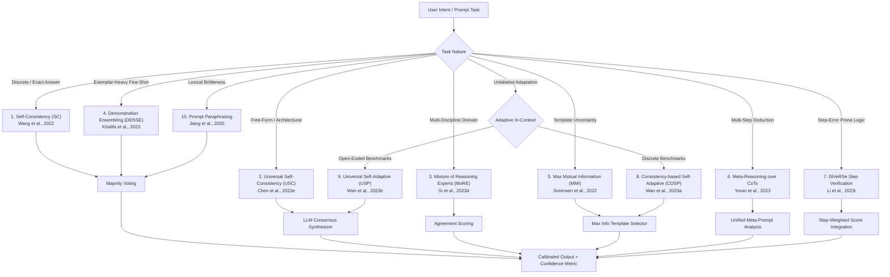

# Prompt Ensembling & Multi-Path Consensus Engineering

> **"A single reasoning path is a hypothesis; an ensemble of diverse reasoning paths is an empirical distribution. Never stake mission-critical architectural or logical decisions on a greedy token trajectory."**
> — *The Prompt Report: A Systematic Survey of Prompting Techniques* (Schulhoff et al., 2025, Section 2.2.4 & Section 6.1.3)

---

## 1. Executive Summary & Epistemic Foundations

Single-turn, greedy decoding ($T=0$) suffers from severe brittleness: local token selection traps, demonstration-order sensitivity, lexical framing bias, and single-point-of-failure hallucinations. **Prompt Ensembling** transforms single-point stochastic generation into a rigorous, verifiable multi-path consensus system.

This skill operationalizes the complete **Ensembling Taxonomy** cataloged in *The Prompt Report* (Schulhoff et al., 2025, Figure 2.2, pages 14–15) and empirical benchmarking standards (Section 6.1.3). It equips Google Antigravity agents to configure, execute, and calibrate multi-prompt ensembles for complex reasoning, architectural synthesis, high-stakes code generation, and ambiguous intent resolution.

```
┌─────────────────────────────────────────────────────────────────────────────────┐
│                           ENSEMBLING ARCHITECTURE MATRIX                         │
├───────────────────────────────┬─────────────────────────────────────────────────┤
│ Diversity Generation Source   │ Consensus & Marginalization Engine              │
├───────────────────────────────┼─────────────────────────────────────────────────┤
│ • Stochastic Decoding (T=0.5) │ • Majority / Plurality Voting (Wang et al.)     │
│ • Prompt Paraphrasing         │ • Universal Semantic Synthesizer (Chen et al.)  │
│ • Exemplar Subsets (DENSE)    │ • Step-Aware Probabilistic Verifier (Li et al.) │
│ • Inductive Experts (MoRE)    │ • Meta-Reasoning CoT Arbitrator (Yoran et al.)  │
│ • Max Mutual Info (MMI)       │ • Agreement-Weighted Borda Tally                │
└───────────────────────────────┴─────────────────────────────────────────────────┘
```

---

## 2. Complete Ensembling Taxonomy (Figure 2.2 Breakdown)

Every technique identified in *The Prompt Report* Section 2.2.4 addresses a distinct vulnerability in the generative lifecycle:



---

### 2.1. Self-Consistency (SC) — Wang et al. (2022 / ICLR 2023)
- **Problem Solved:** Greedy decoding commits irreversibly to the first high-probability token, even if subsequent chain-of-thought (CoT) branches collapse into error.
- **Mechanism:** Samples $k$ independent reasoning paths using non-zero temperature ($T = 0.5$ to $0.7$), parses the canonical answer from each path, and applies marginalization:
  $$\hat{y} = \arg\max_a \sum_{i=1}^k \mathbb{I}(\text{ExtractAnswer}(r_i) = a)$$
- **Antigravity Calibration:**
  - Set sampling temperature $T = 0.5$, Top-P $p = 0.95$.
  - Sample size: $k = 5$ (standard efficiency), $k = 10$ (high-confidence tasks), $k = 20$ (mission-critical mathematical/algorithmic derivations).
- **Consensus Metric:** Minimum acceptable plurality threshold is $\ge 50\%$. If top candidate has $< 40\%$ support, raise divergence alarm.

### 2.2. Universal Self-Consistency (USC) — Chen et al. (2023e)
- **Problem Solved:** Standard Self-Consistency fails on open-ended text, code architectures, design proposals, and narrative explanations because distinct reasoning paths generate non-identical strings that cannot be tallied via string equality.
- **Mechanism:** Ingests $k$ diverse candidate outputs into a second-stage **USC Meta-Synthesizer Prompt**. The model evaluates mutual consistency, isolates shared factual invariants, identifies contradictory outliers, and writes a unified consensus output representing the majority perspective.
- **Antigravity Calibration:**
  - Generate $k=3$ or $k=5$ candidate solutions at $T=0.7$.
  - Feed candidates into the USC Synthesizer prompt with $T=0.2$ for deterministic consensus formulation.

### 2.3. Mixture of Reasoning Experts (MoRE) — Si et al. (2023d)
- **Problem Solved:** Random temperature variation creates syntactic diversity but fails to diversify cognitive perspectives or analytical frameworks.
- **Mechanism:** Dispatches parallel specialized prompt roles with tailored inductive biases and reasoning paradigms:
  1. *Symbolic & Algorithmic Expert:* Enforces formal state invariants, computational complexity, and data structures.
  2. *Empirical & Commonsense Expert:* Evaluates real-world edge cases, operational ergonomics, and practical usability.
  3. *Retrieval & Grounding Expert:* Enforces strict citation of repository files, dependencies, and external documentation.
  4. *Adversarial / Chaos Expert:* Identifies race conditions, security vulnerabilities, and antipodal failure modes.
- **Scoring:** Outputs cross-expert agreement matrices. Unanimous points are accepted immediately; disputed points trigger an explicit arbitration step.

### 2.4. Demonstration Ensembling (DENSE) — Khalifa et al. (2023)
- **Problem Solved:** Few-shot in-context learning is notoriously sensitive to exemplar choice, prompt ordering, and recency bias (the final exemplar dominates output formatting by up to 30%).
- **Mechanism:** Given a curated bank of $N$ exemplars, partition them into $m$ distinct subsets of size $s$ ($N = m \times s$). Query the model across all $m$ subsets in parallel. Aggregate results via majority voting or rank aggregation to wash out exemplar ordering distortion.

### 2.5. Max Mutual Information (MMI) Template Selection — Sorensen et al. (2022)
- **Problem Solved:** Engineering candidate prompt templates without labeled validation data frequently leads to selecting brittle or degenerate prompts.
- **Mechanism:** Selects candidate prompt templates that maximize the Mutual Information $I(X; Y) = H(Y) - H(Y|X)$ between input $X$ and generated output $Y$:
  - Low conditional entropy $H(Y|X)$: Given an input, the model is confident and decisive (low token entropy).
  - High marginal entropy $H(Y)$: Across varied inputs, the model does not collapse into a degenerate trivial answer (e.g., always returning "OK" or "True").
- **Antigravity Rule:** Run MMI when calibrating critical production templates (e.g., automated CI review gates).

### 2.6. Meta-Reasoning over Multiple Chains of Thought — Yoran et al. (2023)
- **Problem Solved:** Majority voting treats every CoT chain as a black-box voter, ignoring intermediate error detection. One brilliant path with a tiny calculation slip gets outvoted by three mediocre, concordant wrong paths.
- **Mechanism:** A two-phase dialectical pipeline:
  - *Phase 1:* Generate $k=4$ diverse CoT reasoning trajectories at $T=0.7$.
  - *Phase 2:* A single meta-prompt consumes all $k$ reasoning traces simultaneously. The meta-agent cross-examines premises, flags where arithmetic or logic diverged in paths A vs. B, prunes hallucinated intermediate steps, and derives the verified conclusion.

### 2.7. DiVeRSe (Diverse Verifier on Reasoning Steps) — Li et al. (2023i)
- **Problem Solved:** Errors in long-chain reasoning compound exponentially; later reasoning steps become meaningless if an early premise failed.
- **Mechanism:** Three distinct pillars:
  1. Diverse prompt variations (multiple paraphrased templates).
  2. Diverse reasoning paths ($k$ generated samples per prompt).
  3. **Step-Aware Verification:** A step-verifier model or subagent scores each step $s_{i,j}$ in reasoning path $i$ with a validity probability $v(s_{i,j}) \in [0, 1]$.
  $$\text{PathScore}(i) = \prod_{j=1}^{L_i} v(s_{i,j}) \quad \text{or} \quad \frac{1}{L_i} \sum_{j=1}^{L_i} \log v(s_{i,j})$$
  The final prediction is selected via step-confidence weighted voting rather than unweighted majority count.

### 2.8. Consistency-based Self-Adaptive Prompting (COSP) — Wan et al. (2023a)
- **Problem Solved:** Selecting in-context demonstrations for domain-specific tasks without gold labels.
- **Mechanism:** Measures prediction consistency across unlabeled target inputs when prompted with candidate demonstration sets. The demonstration configuration that yields the highest agreement (least entropy/dispersion) across the target query set is selected dynamically.

### 2.9. Universal Self-Adaptive Prompting (USP) — Wan et al. (2023b)
- **Problem Solved:** Extends COSP to open-ended generative and unstructured tasks.
- **Mechanism:** Evaluates prompt candidates across a dual tensor of token entropy and universal semantic self-consistency clustering. Selects optimal few-shot exemplars and instructions on the fly based on query complexity.

### 2.10. Prompt Paraphrasing — Jiang et al. (2020 / EMNLP)
- **Problem Solved:** LLMs have sharp sensitivity to arbitrary phrasing ("lexical brittleness"). Slight syntactic rewordings can alter model accuracy by $10–25\%$.
- **Mechanism:** Automatically generates $P$ distinct syntactic paraphrases of the instruction (using varied sentence structures, formal vs. imperative tone, active vs. passive voice). Queries are executed across all $P$ paraphrases, and results are marginalized to eliminate linguistic bias.

---

## 3. Cost vs. Accuracy Trade-Off Matrix

Ensembling trades inference compute for reliability. Use this decision matrix to select the right technique for your engineering budget:

| Technique | Token Multiplier | Latency Impact | Reasoning Accuracy $\Delta$ | Ideal Antigravity SDLC Phase |
| :--- | :--- | :--- | :--- | :--- |
| **Prompt Paraphrasing** | $3\times - 5\times$ | Parallel ($1\times$) | $+4\% - +8\%$ | Phase 01: Intent Clarification |
| **Self-Consistency (SC)** | $5\times - 10\times$ | Parallel ($1\times$) | $+8\% - +18\%$ | Phase 04: Algorithmic & Test Generation |
| **Universal SC (USC)** | $3\times - 5\times + \text{Synth}$ | $2\times$ sequential | $+10\% - +20\%$ | Phase 01 & 02: PRD & Architecture Consensus |
| **MoRE (Mixture of Experts)** | $4\times + \text{Arbiter}$ | $2\times$ sequential | $+12\% - +22\%$ | Phase 02: Deep Module & Security Design |
| **Meta-Reasoning CoT** | $4\times + \text{Meta}$ | $2\times$ sequential | $+14\% - +25\%$ | Phase 04: Hard Bug Root Cause Analysis |
| **DENSE (Demonstrations)** | $3\times - 6\times$ | Parallel ($1\times$) | $+6\% - +12\%$ | Phase 03: Scoped Priming & Few-Shot Tasks |
| **DiVeRSe** | $10\times - 20\times$ | $3\times$ sequential | $+18\% - +30\%$ | Phase 05: Dark Factory Critical Verification |
| **MMI Selection** | $5\times$ (One-time) | Batch prep | $+5\% - +10\%$ | Phase 05: Rule & Prompt Production Tuning |
| **USP / COSP** | $6\times - 12\times$ | $2\times$ sequential | $+9\% - +15\%$ | Phase 03: Adaptive Context Assembly |

---

## 4. Temperature & Sampling Calibration Protocols

Ensembling fails if diversity collapses (too cold) or if reasoning degenerates into nonsense (too hot). Calibrate according to empirical findings:

```
[Temperature Scale Calibration]
0.0       0.2              0.5              0.7              1.0              1.4
 ├─────────┼────────────────┼────────────────┼────────────────┼────────────────┤
 │ Greedy  │ USC Synthesizer│ Standard SC    │ MoRE & Meta-CoT│ Dangerous      │ Hallucination
 │ Baseline│ & Meta-Arbiter │ (Wang et al.)  │ Diversity      │ Entropy Spike  │ Meltdown
 └─────────┴────────────────┴────────────────┴────────────────┴────────────────┘
```

1. **Self-Consistency Exploration ($T = 0.5$, Top-P $0.95$):**
   - High enough to sample alternative token trajectories at ambiguous junction points.
   - Low enough to preserve logical validity across all steps.
2. **Mixture of Experts & Paraphrasing ($T = 0.7$, Top-P $0.90$):**
   - Allows creative syntactic variance and divergent problem framing.
3. **Consensus Synthesis & Meta-Reasoning ($T = 0.1 - 0.2$, Top-P $1.0$):**
   - The aggregation stage must be ruthlessly deterministic and objective.
   - Never run meta-synthesis at $T \ge 0.5$.

---

## 5. Execution Protocols (Modes)

When invoking `/prompt-ensembling`, select from the 4 primary operational modes:

### Mode 1: `--mode self-consistency` (Discrete Logic & Code)
1. Generate $k$ parallel reasoning streams with prompt:
   - System: `"Solve the problem step by step. Output the final result in the closing delimiter: <<<RESULT>>>."`
   - Temperature: `0.5`, Samples: `k` (default 7).
2. Regex-extract content between `<<<` and `>>>`.
3. Normalize extracted tokens (strip whitespace, lowercase booleans, parse AST or numerical values).
4. Compute frequency distribution.
5. If top candidate frequency $\ge \lceil (k+1)/2 \rceil$, return candidate with confidence metric.
6. If plurality is below $40\%$, trigger fallback warning.

### Mode 2: `--mode more` (Mixture of Reasoning Experts)
1. Instantiate 4 parallel expert prompts:
   - **Expert A (Architectural / Deep Module):** Focuses on cohesion, information hiding, and clean interfaces.
   - **Expert B (Resilience & Reliability):** Focuses on failure modes, error propagation, and recovery.
   - **Expert C (Performance & Resource Ergonomics):** Focuses on memory footprints, latency, and algorithmic complexity.
   - **Expert D (Simplicity & Blast Radius):** Focuses on YAGNI, least-privilege, and pragmatic minimalism.
2. Collect expert analyses at $T=0.7$.
3. Execute Agreement Matrix:
   - Identify consensus invariants (accepted by $\ge 3$ experts).
   - Identify tension points (conflicts between performance and simplicity).
4. Run Arbitration synthesis ($T=0.2$) producing the balanced resolution.

### Mode 3: `--mode meta-reasoning` (Deep Multi-Path Debugging & Root Cause)
1. Generate $k=4$ diverse CoT diagnostic traces for a hard bug or architectural bottleneck.
2. Assemble all 4 traces into the **Meta-Reasoning Harness**:
   - `Chain 1:` ...
   - `Chain 2:` ...
   - `Chain 3:` ...
   - `Chain 4:` ...
3. Direct the Meta-Reasoner to:
   - Identify shared baseline premises across chains.
   - Audit each chain for hidden calculation errors, unverified assumptions, or invalid API expectations.
   - Isolate the single chain that survives dialectical scrutiny.
   - Output the synthesized root cause and verified remediation.

### Mode 4: `--mode dense` (Exemplar Subset Ensembling)
1. Ingest user exemplar pool (e.g., 9 few-shot test cases or code snippets).
2. Partition into $m=3$ subsets of 3 exemplars each, rotating presentation orders to cancel recency bias.
3. Query target input against all 3 subsets in parallel.
4. Marginalize candidate outputs via majority vote or Universal SC synthesizer.

---

## 6. Concrete Before & After Prompt Implementations

### Example 1: Self-Consistency (Wang et al.) for Algorithmic Invariants

#### ❌ BEFORE (Naive Single Greedy Prompt)
```markdown
Is the following cache eviction algorithm thread-safe under concurrent writes?
[Code snippet]
Provide your answer.
```
*Failure Mode:* The model generates a plausible explanation, misses an edge-case race condition in the lock-free CAS loop, and confidently states "Yes, it is thread-safe."

#### ✅ AFTER (Self-Consistency with Calibrated Marginalization)
```markdown
[System]: You are a concurrent systems verification engine.
Analyze the following cache implementation for thread safety under concurrent writes.
Proceed step-by-step:
1. Trace pointer manipulations during concurrent write contention.
2. Inspect the CAS loop memory ordering semantics.
3. Identify any ABA vulnerability or memory reclamation race.
4. Conclude with exactly "CONCLUSION: THREAD_SAFE" or "CONCLUSION: VULNERABLE".

[Input Code Snippet]
```
*Execution:* Sample $k=7$ independent traces at $T=0.5$.
*Result Tally:*
- 5 traces identify ABA race condition in node recycling $\rightarrow$ `"CONCLUSION: VULNERABLE"`
- 2 traces miss the race condition $\rightarrow$ `"CONCLUSION: THREAD_SAFE"`
*Ensemble Resolution:* `"CONCLUSION: VULNERABLE"` (Confidence: $71.4\%$). Dispatches fix before production deploy.

---

### Example 2: Universal Self-Consistency (Chen et al.) for Architecture Design

#### ❌ BEFORE (Single-Prompt Architecture Request)
```markdown
Design an authentication and session management system for our multi-tenant SaaS.
```
*Failure Mode:* Returns a generic JWT implementation that overlooks cross-tenant data leakage via tenant ID spoofing in access tokens.

#### ✅ AFTER (Universal SC Multi-Stream Pipeline)
1. **Parallel Generation ($k=3$, $T=0.7$):**
   - Stream 1 (Stateful focus): Redis session store with sliding TTL.
   - Stream 2 (Stateless focus): Cryptographically signed asymmetric JWTs with tenant claims.
   - Stream 3 (Hybrid focus): Stateless tokens with centralized revocation list.

2. **USC Meta-Synthesizer Prompt ($T=0.1$):**
```markdown
You are the Chief Software Architect. Below are 3 independently drafted architectural proposals for a multi-tenant authentication system:

=== PROPOSAL 1 ===
[Proposal 1 Content]

=== PROPOSAL 2 ===
[Proposal 2 Content]

=== PROPOSAL 3 ===
[Proposal 3 Content]

Your task is to execute Universal Self-Consistency consensus synthesis:
1. IDENTIFY SHARED INVARIANTS: What security and operational patterns do all 3 proposals agree are mandatory?
2. RESOLVE CONFLICTS: Where do the proposals disagree (e.g., token revocation latency vs. database load)? Select the approach that minimizes blast radius and operational complexity.
3. PRUNE OUTLIERS: Eliminate speculative or ungrounded claims made in only one proposal.
4. SYNTHESIZE MASTER SPECIFICATION: Output a unified, production-grade architectural specification representing the hardened consensus.
```

---

### Example 3: Mixture of Reasoning Experts (MoRE - Si et al.) for PRD Review

```markdown
=== EXPERT 1: SAGE (Domain & Invariant Rigor) ===
Prompt: "Audit this PRD strictly for domain modeling integrity, boundary leaks, and semantic ambiguity. Flag terms used inconsistently."

=== EXPERT 2: ARTISAN (Implementation & Ergonomics) ===
Prompt: "Audit this PRD strictly from the perspective of developer implementation friction. Where will the engineer get stuck? What interfaces are underspecified?"

=== EXPERT 3: SHADOW (Adversarial Security & Abuse) ===
Prompt: "Assume an attacker or bad actor wants to exploit this feature. Trace abuse vectors, quota exhaustion, and state corruption."

=== EXPERT 4: SOVEREIGN (Pragmatism & Blast Radius) ===
Prompt: "Act as staff engineer enforcing YAGNI. Prune 30% of this feature set to create the thinnest viable tracer bullet."
```
*Arbitration Engine:* Combines all 4 reviews into an OKF PRD Risk Scorecard with explicit mitigation tickets.

---

## 7. Operational CLI Runbook

To invoke this skill within Antigravity:

```powershell
# 1. Run standard Self-Consistency over a logic or math prompt (k=7 samples)
/prompt-ensembling "Verify the correctness of our decimal rounding calculation in src/billing/tax.ts" --mode self-consistency --samples 7

# 2. Run Mixture of Reasoning Experts on an architectural decision
/prompt-ensembling "docs/adr/0004-event-driven-notifications.md" --mode more

# 3. Run Meta-Reasoning over multiple CoTs for an elusive crash
/prompt-ensembling "Intermittent deadlock in database connection pool under high pool saturation" --mode meta-reasoning --samples 4

# 4. Run Demonstration Ensembling across custom few-shot exemplars
/prompt-ensembling "Translate legacy SOAP XML to REST JSON payloads" --mode dense --samples 3
```

---

## 8. Integration with Unified Skills Suite

- **Upstream Trigger:** Dispatched by `/ask-skills` when users demand high-certainty alignment, or by `/grill-with-duality` when trade-offs require multi-perspective synthesis.
- **Peer Collaboration:** Integrates with `/council-centroidal-deliberation` by supplying the mathematical ensembling and consensus mechanisms for archetype turns.
- **Downstream Hand-off:** Synthesized consensus outputs feed directly into:
  - `skills/01-alignment-intent/plan-create-prd/` (PRD hardening via USC)
  - `skills/02-architecture-specs/plan-centroidal-architecture/` (MoRE structural balance)
  - `skills/04-execution-quality/tdd/` (Self-Consistent test case generation)

---

## 9. Academic References & Grounding

1. **Schulhoff et al. (2025):** *The Prompt Report: A Systematic Survey of Prompting Techniques.* arXiv:2406.06608.
   - Section 2.2.4: Ensembling (Figure 2.2, pages 14–15).
   - Section 6.1.3: Self-Consistency Benchmarking.
2. **Wang et al. (2022 / ICLR 2023):** *Self-Consistency Improves Chain of Thought Reasoning in Language Models.* arXiv:2203.11171.
3. **Chen et al. (2023e):** *Universal Self-Consistency for Large Language Models.* arXiv:2311.17311.
4. **Si et al. (2023d):** *Prompting GPT-3 To Be Reliable (MoRE).* arXiv:2210.09150.
5. **Khalifa et al. (2023):** *A Few-Shot Demonstration Ensembling Approach (DENSE).*
6. **Sorensen et al. (2022):** *An Information-theoretic Approach to Prompt Engineering Without Labels (Max Mutual Information).* arXiv:2203.13972.
7. **Yoran et al. (2023):** *Answering Questions by Meta-Reasoning over Multiple Chains of Thought.* arXiv:2304.13007.
8. **Li et al. (2023i):** *Making Large Language Models Better Reasoners with Step-Aware Verifier (DiVeRSe).* arXiv:2206.02336.
9. **Wan et al. (2023a):** *Self-Adaptive In-Context Learning (COSP).*
10. **Wan et al. (2023b):** *Universal Self-Adaptive Prompting for Language Models (USP).*
11. **Jiang et al. (2020 / EMNLP):** *How Can We Know What Language Models Know? (Prompt Paraphrasing).*
