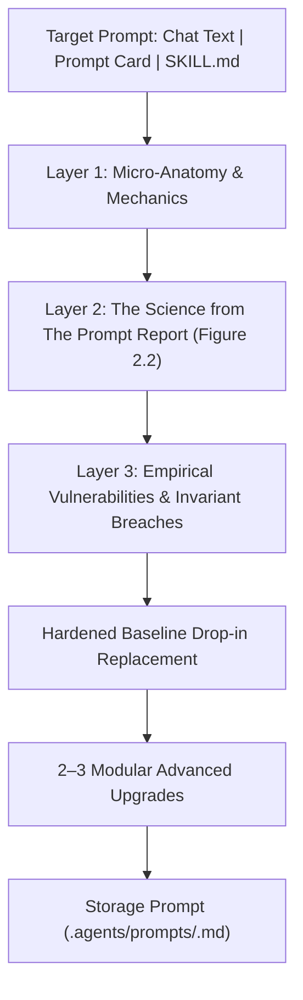
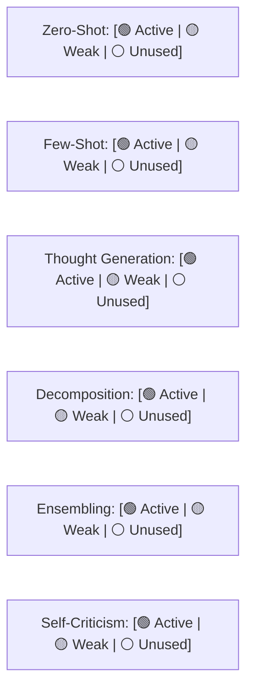

# PromptExplainer: Empirical Prompt Deconstruction & Pedagogical Hardener
*Grounded in 'The Prompt Report: A Systematic Survey of Prompt Engineering Techniques' (Schulhoff et al., 2025)*

`prompt-explainer` (callable via `/prompt-explain` or `/prompt-explainer`) transforms any prompt template—whether pasted directly in chat, saved in `.agents/prompts/*.md`, or defined inside a skill (`skills/**/SKILL.md`)—into a **rigorous pedagogical case study**.

It uses your specific prompt as a concrete living example to teach the underlying science from *The Prompt Report*, exposes empirical blind spots, and provides an immediate hardened drop-in replacement with modular upgrades.

---

## 🏛️ The Three-Layer Pedagogical Architecture

Every analysis executed by `prompt-explainer` adheres to a strict three-layer educational sequence:



### Layer 1: Micro-Anatomy & Generation Mechanics
Dissects the prompt into individual semantic blocks, explaining how each block impacts the model's forward pass, tokenization, and autoregressive attention distribution:
- **Directives & Role Conditioning:** How system-level and role tokens shape stylistic and domain priors (§1.2.1).
- **Context & Knowledge Ingestion:** How reference information is placed relative to attention decay and "Lost in the Middle" phenomena.
- **Delimiter Hygiene:** How boundary markers (tags, brackets, hashes) structure the model's internal parser.
- **Output Constraints & Verbalizers:** How formatting rules alter the model's output distribution.

### Layer 2: The Science from *The Prompt Report* (Figure 2.2 Taxonomy)
Maps the prompt against the 6 foundational families of prompt techniques from Figure 2.2:
1. **Zero-Shot Techniques (§2.2.1.3):** Role, S2A, SimToM, RaR, RE2, Self-Ask.
2. **Few-Shot In-Context Learning (§2.2.1):** 6 exemplar design decisions, Vote-K, KNN, AutoDiCoT contrastive pairs.
3. **Thought Generation (§2.2.2):** CoT, Step-Back abstraction, Thread-of-Thought (ThoT), Tab-CoT.
4. **Decomposition (§2.2.3):** Least-to-Most DAG, Plan-and-Solve, Skeleton-of-Thought (SoT), DECOMP.
5. **Ensembling (§2.2.4):** Self-Consistency ($T=0.5$), Mixture of Reasoning Experts (MoRE), Universal SC.
6. **Self-Criticism & Verification (§2.2.5 & §4.2):** Chain-of-Verification (COVE), ReverseCoT, ChatEval debate.

Outputs a **Mermaid Taxonomy Radar** and a **Literature Citation Scorecard** showing which techniques are active, weak, or missing.

### Layer 3: Empirical Vulnerabilities & Blind Spots
Audits the prompt against documented failure modes in the paper:
- **Format-Reasoning Collision (§2.5 & Tam et al.):** Is the prompt forcing strict JSON in the same pass as reasoning, degrading logical depth?
- **Sycophancy & False Presupposition (Footnote 12, §5.2.2):** Does the prompt ask leading questions (e.g. *"Find why this is insecure"*) that trigger false positives?
- **Order Sensitivity (§2.2.1.1 Lu et al.):** If exemplars exist, are they causing recency bias swings (50% $\to$ 90% variance)?
- **Package Hallucination (§5.1.2.2):** If code generation is involved, does it lack dependency whitelisting?

---

## 📋 Standard Output Format

When you run `/prompt-explain` on any prompt, the skill delivers:

```markdown
# 🔬 Prompt Deconstruction: [Prompt Summary / Name]

## 1. Micro-Anatomy & Mechanics
- **`<instructions>` Block:** [Analysis of directives and attention steering]
- **`<context>` / Input Slots:** [Analysis of context density and token placement]
- **Output Framing:** [Analysis of format restrictions and decoding constraints]

## 2. Taxonomy Placement & Literature Mapping (Figure 2.2)



| Dimension | Active Technique | Paper Grounding | Status & Notes |
| :--- | :--- | :--- | :--- |
| **Reasoning** | [e.g. None / Generic CoT] | Wei et al. (§2.2.2) | 🟡 Needs domain thought inducer or Step-Back |
| **Exemplars** | [e.g. Unbalanced Few-Shot] | Lu et al. (§2.2.1.1) | ⚠️ Vulnerable to ordering & recency bias |
| **Verification**| [e.g. Missing] | Dhuliawala et al. (§2.2.5) | ⚪ High hallucination risk |

## 3. Empirical Diagnosis & Vulnerability Audit
- ⚠️ **Defect 1:** [e.g. Format Collision — Forcing raw JSON during multi-step reasoning suppresses tokens]
- ⚠️ **Defect 2:** [e.g. Missing RE2 Anchor — Constraints at the top decay in attention by end of prompt]

## 4. Hardened Baseline Drop-in Replacement
[Immediately usable, corrected prompt template with Canonical XML Delimiters and decoupled scratchpad]

## 5. Modular Advanced Upgrades
- **[1] Upgrade 1 — [Technique Name] (Paper §):** [What it adds and why]
- **[2] Upgrade 2 — [Technique Name] (Paper §):** [What it adds and why]
- **[3] Upgrade 3 — [Technique Name] (Paper §):** [What it adds and why]

*👉 To apply an upgrade, reply with its number (e.g. 'Apply 1').*

─────────────────────────────────────────────────────────────────────────────
💾 Would you like me to store this baseline prompt in `.agents/prompts/<name>.md`?
Reply with your desired prompt name or 'skip'.
─────────────────────────────────────────────────────────────────────────────
```

---

## ⚡ Interactive Upgrade Flow

If the user replies with:
- `"1"` or `"Apply Upgrade 1"` $\to$ immediately re-compiles the prompt incorporating that specific advanced technique from *The Prompt Report*, explains the diff, and presents the new template.
- `"Save as <name>"` $\to$ writes the finalized prompt specification card to `.agents/prompts/<name>.md`.
