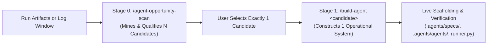

# Agent Opportunity Scan — Mining Workflows for Autonomous Agentification (v2.0)
*Grounded in the Top 5 Foundational Standards: Zhiheng Xi et al. (86pp survey, Fudan 2025), CoALA Cognitive Architecture (Sumers et al., TMLR 2024), Anthropic's "Building Effective Agents" & MCP (2024), Oracle agent-spec / Agent Protocol, and Andrew Ng & Harrison Chase Frameworks.*

`agent-opportunity-scan` is the upstream discovery engine of the **Autonomous Agent Engineering Suite**. It mines developer sessions, execution runs, or multi-week command logs to find high-toil, repetitive, or complex workflows that qualify for **autonomous agentification**.

> **Attribution & Lineage:** Repurposed and retrofitted from **Cole Medin's** foundational [`opportunity-scan`](../opportunity-scan/SKILL.md) skill ([Cole Medin GitHub: @coleam00](https://github.com/coleam00)). While Cole's original tool discovers general AI-layer improvements (rules, hooks, general skills), `agent-opportunity-scan` adapts the discovery paradigm specifically for **active autonomous agentification** with 4-filter qualification, AVS scoring, and draft specs.

It acts as **Stage 0** in a predetermined sequential two-stage automation pipeline:



---

## 1. Inputs — Required Target First, Then Steer

Read `$ARGUMENTS` as prose following the two-target scanning pattern:

1. **Target to Scan** *(required)* — exactly one of:
   - **A RUN (Reactive Mining):** The artifacts, transcripts (`transcript.jsonl`), and diffs of a specific completed run. Asks: *"What manual friction, multi-step error recovery, or idle turn-taking in this run should be offloaded to an autonomous agent?"*
   - **A WINDOW OF LOGS (Proactive Mining):** A directory containing session logs or shell command histories (e.g. Antigravity transcripts, `.agents/history.jsonl`, git command history) over a timeframe (default: 2 weeks). Asks: *"What recurring development toil across recent sessions justifies engineering a dedicated agent or daemon?"*
2. **User Steer** *(optional)* — the theme you care about (e.g. *"focus on test-run flakiness"*, *"look for cross-platform friction"*, *"find repetitive review steps"*).
3. **Flags** *(optional)*:
   - `--auto-spec`: In addition to displaying the candidate dossiers, immediately scaffolds a draft Oracle specification `.agents/specs/<candidate-id>.spec.yaml` for the top-ranked candidate.

---

## 2. The Dual-Tier Agent Viability Taxonomy

To ensure agents are built only when genuinely justified—and to prevent over-engineering simple scripts or prompt templates into complex agent harnesses—candidates must undergo a two-tier evaluation from [`resources/candidate-rubric.md`](resources/candidate-rubric.md):

### 🔴 Tier 1: The 5 Critical Qualification Gates (Non-Negotiable)
A candidate workflow **MUST satisfy ALL 5 gates** to qualify for autonomous agentification via `/build-agent`. If any single gate fails, the candidate is routed to a simpler primitive:

1. **CG-1: Dynamic State & Branching (Anthropic §2):** The task requires non-deterministic exploration, branching logic, or dynamic runtime decision trees. It cannot be resolved via a static linear script or single prompt. *(If failed: recommend Rule or Shell Script).*
2. **CG-2: External Tool Mutation (CoALA §3):** The task must execute *External Actions* (file I/O, terminal commands, AST queries, REST/MCP APIs) that inspect and mutate the system environment. *(If failed: recommend Prompt or Skill).*
3. **CG-3: Reflexion & Error Recovery (Ng Pattern 1 & Xi et al. §3.3):** The execution environment exhibits runtime surprises (test failures, syntax errors, platform traps). The agent must catch exceptions, inspect logs, and iteratively self-correct. *(If failed: recommend Git Pre-Commit Hook).*
4. **CG-4: Measurable Toil Justification (Chip Huyen §3):** The workflow consumes $\ge 15$ minutes of active human toil per week or occurs with recurring frequency ($AVS \ge 50$), justifying the engineering cost of a micro-harness and test suite. *(If failed: keep as Ad-hoc Interactive Task).*
5. **CG-5: Containable Blast Radius (Oracle agent-spec & SWE-bench):** External mutations can be strictly bounded within an isolated directory, branch, or verified with an automated git working-tree rollback mechanism (`git stash`). *(If failed: keep as Human-Only Task).*

### 🟢 Tier 2: The 5 Optional Value-Add Enhancers (Architectural Multipliers)
These criteria are **not required** to build an agent, but when present, they substantially increase the candidate's **Agent Viability Score (AVS)** and determine which advanced architectural capabilities are scaffolded into `/build-agent`:

- **OE-1: Episodic Cross-Session Memory (Harrison Chase & CoALA §2):** Persists historical execution logs, past failure modes, or performance metrics across sessions.
- **OE-2: Multi-Perspective Deliberation / Adversarial Check (Xi et al. §4 & Anthropic §4):** Benefits from opposing roles (Creator vs. Critic, Security vs. Performance) and promotes the agent to `multi-agent-squad`.
- **OE-3: Persistent Sentinel Scheduling / Daemon Vigilance (Anthropic §5):** Requires background polling, file watching, interval cron timers, or liveness health checks (`autonomous-sentinel`).
- **OE-4: Dynamic Model Context Protocol (MCP) Integration (Anthropic MCP Spec):** Interacts with third-party tools or external services (GitHub, Linear, Postgres, Stripe, browser).
- **OE-5: Multimodal Sensory Grounding (Xi et al. §3.2):** Inspects visual artifacts, UI screenshots, rendered DOM trees, or PDF diagrams (`agent-browser`).

---

## 3. Agent Viability Score (AVS) Formulation

$$\text{AVS} = \frac{\text{Monthly Frequency} \times \text{Mean Human Toil (Minutes)}}{\text{Blast Radius Factor}} \times \left(1 + 0.15 \times N_{\text{optional}}\right)$$

Where:
- **Blast Radius Factor:** `1.0` (read-only/scratchpad), `1.5` (scoped git working tree writes), `2.5` (external APIs/DBs), `4.0` (destructive shell).
- $N_{\text{optional}}$: Count of Tier-2 Optional Enhancers met ($0 \le N_{\text{optional}} \le 5$), granting up to a **+75% priority bonus**.

---

## 4. Execution Workflow

### Step 1: Ingest & Scrutinize the Target
Run the scanner script or inspect the target directly:
```powershell
python skills/05-meta-autonomy/agent-opportunity-scan/scripts/scan-agent-opportunities.py "<transcript-or-log-path>" [--auto-spec <id>]
```

### Step 2: Filter & Qualify
- Evaluate detected friction patterns against the **5 Critical Gates**.
- Score qualifying candidates across the **Tier 2 Optional Enhancers**.
- Rank all passing candidates in descending order of AVS.

### Step 3: Author Pre-Filled Specification Dossiers
For each qualified candidate, assemble a dossier designed to plug directly into **Stage 1 of `/build-agent`**:
- **Candidate Identifier & Archetype** (`solo-tool-user`, `multi-agent-squad`, `autonomous-sentinel`)
- **Observed Friction & Session Evidence** (exact quotes, turn counts, error logs)
- **Tool Palette & CoALA Action Boundary**
- **Definition of Done (DoD) & Acceptance Criteria**
- **Fired Conditions** (zero-tolerance failure modes)
- **Direct `/build-agent` Command**

### Step 4: Present Interactive Decision to The User
Render the interactive HTML dashboard (`agent-opportunity-report.html`) and present the candidate list in chat:

```text
Found N Qualified Agent Opportunities:

1. [Candidate Name] ([Archetype]) — AVS: [Score]
   - Projected Savings: ~X hours/month
   - Critical Gates: 5/5 PASSED | Optional Enhancers: Y/5
   - Direct 1-Click Handoff: /build-agent --from-spec .agents/specs/<candidate-id>.draft.yaml

─────────────────────────────────────────────────────────────────────────────
👉 Sequential Second Step: Which agent would you like to build right now?
   Reply with the candidate number (e.g. '1') to immediately execute /build-agent --from-spec.
─────────────────────────────────────────────────────────────────────────────
```

---

## 5. Sequential Interlock with `/build-agent`

`agent-opportunity-scan` and `build-agent` are designed to run in strict sequence:
1. `agent-opportunity-scan` can suggest **as many agents as meet the criteria** (broad discovery).
2. Automatically authors an Oracle agent-spec compliant draft in `.agents/specs/<candidate-id>.draft.yaml`.
3. Invoking `/build-agent --from-spec .agents/specs/<candidate-id>.draft.yaml` hydrates the Stage 1 Spec Sheet directly from the YAML fields, skipping redundant Q&A and jumping straight to Stage 2 Approval and Stage 6 Automated Verification.

---

## 6. Closing the Loop: Deployed Agent Retrospectives via `/opportunity-scan`

Once an agent is constructed by `/build-agent` and runs live in your project:
- **Do not introduce redundant retro skills.** Use the existing [`/opportunity-scan`](../opportunity-scan/SKILL.md) reactive loop directly on the agent's run artifacts:
  ```bash
  /opportunity-scan .agents/reports/<agent-name>/ [symptom or error description]
  ```
- **What it does:** Reconstructs the agent's execution trajectory, isolates tool ping-pong, context bloat, or invariant violations, and prescribes the smallest durable fix.
- **The Upgrade Loop:** Maps findings directly back into:
  ```bash
  /build-agent --upgrade <agent-name>
  ```
  This creates a complete, self-healing continuous loop: **Scan Opportunity $\rightarrow$ Build Agent $\rightarrow$ Auto-Verify $\rightarrow$ Production Run $\rightarrow$ Opportunity Scan on Agent $\rightarrow$ Upgrade Agent**.
